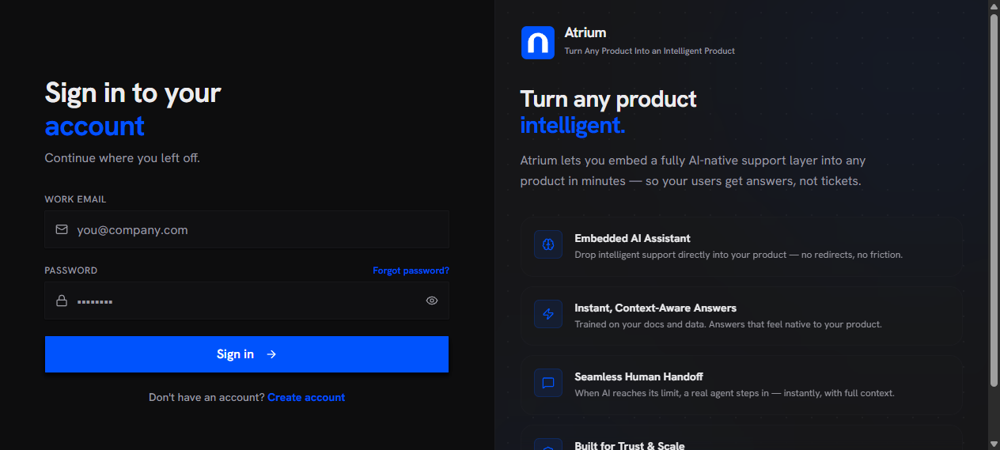

<p align="center">
  
</p>

<h1 align="center">Atrium</h1>

<p align="center">
  <b>Self-hostable customer support platform — AI agents, RAG over your own knowledge, and human handoff.</b>
</p>

<p align="center">
  <sub>TypeScript monorepo: gateway API · agent runtime · queue workers · React dashboard · embeddable widget</sub>
</p>

<p align="center">
  
</p>

---

## What this is

Atrium answers customer questions on WhatsApp, email, Telegram and an embeddable website widget. An AI
agent resolves what it can from a retrieval-augmented knowledge base, escalates to a human when it should,
and every conversation, contact and ticket lands in one inbox.

It is built as a **pnpm workspace of five independent applications** sharing one gateway contract, so the AI
brain, the queue workers and the dashboard deploy and scale separately.

## Architecture

| App | Role |
|---|---|
| `apps/gateway` | The API. Routing, authentication, tenant isolation, channel webhooks, rate limiting, sockets |
| `apps/agent` | The AI brain. LLM orchestration, tool calling, retrieval over the knowledge base, MCP tools |
| `apps/worker` | Background jobs and queues — email, usage, subscription lifecycle |
| `apps/console` | The admin dashboard: inbox, contacts, CRM pipeline, knowledge, widgets, billing |
| `apps/launcher` | The embeddable website widget — a standalone bundle with its own message protocol |

| Infrastructure | Purpose |
|---|---|
| MongoDB | Primary store |
| Redis | Queues, caching, rate limits |
| Qdrant | Vector store for retrieval |
| Silo | Static asset hosting for the widget bundle |
| Mailhog | Local email capture in development |

## Running it

**Prerequisites:** Node **22.x**, pnpm **9.15.0**, Docker. Both versions are pinned in `package.json`, so
`corepack` picks them up automatically.

```bash
git clone https://github.com/Marwanelh/atrium.git
cd atrium

pnpm install --frozen-lockfile

# environment: every app ships a committed example with placeholders
for f in $(find . -name .env.example -not -path "./node_modules/*"); do
  cp "$f" "$(dirname "$f")/.env"
done

# backing services
cd docker && docker compose -f docker-compose.dev.yml up -d redis mongodb mongo-express mailhog silo qdrant && cd ..

# dev servers
pnpm run dev
```

The console comes up on **http://localhost:5173** and the gateway on **:3000**.

No real secrets are committed — the `.env` files are gitignored and every example value is a placeholder.

## Verification

Measured on this repository, not copied from a marketing page:

| Check | Result |
|---|---|
| `pnpm run verify:build` | **passes** — all five applications build |
| `pnpm run verify:types` | **passes** — no TypeScript errors |
| `pnpm run verify:test` | **passes** — 13 test files, 88 tests |
| `pnpm run verify:lint` | **fails** — 72 `no-explicit-any` and 9 other lint findings |

The lint failures are recorded rather than silenced. The majority are explicit `any` annotations in the
dashboard — typing debt, not defects. CI runs the same four commands, so a green check means these commands
actually passed.

## Security

Hardening applied to this repository, with the reasoning behind each change:

- **Dependency audit driven to near-clean.** `pnpm audit` reported 308 advisories including one critical.
  Updating within declared semver ranges cut that to 38 and removed every critical and high-severity
  advisory in production dependencies. Remaining findings are transitive and tracked.
- **Fail-closed secret validation.** The gateway refuses to boot in production when `JWT_SECRET` or
  `AI_TOOL_SECRET` still equals the value published in the committed docker templates. A published secret
  is not a secret, so the process exits with instructions to generate one rather than starting with
  forgeable tokens. Development is unaffected. Verified against all three paths: production with template
  values **refuses**, production with real values **boots**, development **boots**.
- **CORS credentials removed.** The gateway reflected any request origin *and* allowed credentials. With
  bearer tokens in the `Authorization` header — which browsers never attach automatically — credentials were
  unnecessary and the pair was a textbook cross-origin exposure. `credentials` is now `false`; the origin
  set stays open because the embeddable widget runs on customer domains by design.
- **Default admin credential removed from the tree.** A committed basic-auth file shipped a known password
  hash. It is now generated on install and gitignored, so a deployment cannot inherit a published password.
- **Unused third-party dependency removed.** A scoped package present in the manifest but imported by zero
  files was dropped, shrinking the supply-chain surface.

### Recommendations for a production deployment

This repository runs locally with placeholder configuration. Before exposing it publicly:

1. **Terminate TLS and keep backing services private.** MongoDB, Redis and Qdrant should never be reachable
   from the internet; only the gateway should be.
2. **Move secrets into a secret manager.** The fail-closed guard prevents *published defaults*, not weak
   values — supply real entropy from the environment or a vault.
3. **Treat the agent as an untrusted boundary.** Sanitise model input and output, and enforce per-tenant
   usage quotas so a prompt-injection or runaway loop cannot produce an unbounded bill.
4. **Rotate channel webhook signing secrets** and verify signatures on every inbound provider callback.
5. **Put rate limits in front of auth and chat endpoints** — the Redis-backed limiter exists; configure it
   per tenant rather than leaving defaults.

## Engineering notes

Work done on this codebase:

- **Removed a non-redistributable module.** A separately-licensed enterprise directory cannot be
  redistributed. It is gone, and the removal degrades through the existing feature gate — module presence
  reports false, availability reports false, and callers deny explicitly — rather than failing at runtime
  with a missing module. Verified by building and testing with the directory absent.
- **Made CI honest.** The inherited workflow could not fail: every step ended in `|| true`, so the badge was
  green regardless of what the linters found, and it installed its own global linters instead of using the
  project's. It now runs one required job on Node 22 with a frozen install and the same aggregate contract a
  contributor runs locally, and nothing in it can mask an exit status.
- **Fixed the type gate.** There was exactly one TypeScript error, in a test fixture whose array literal
  inferred as `(string | number)[][]` and matched none of `Map`'s tuple overloads.
- **Removed dead code.** 239 lines of unreachable JSX behind a `false &&` guard, plus the thirteen symbols
  that block was the only consumer of.
- **Fixed four defects** the linter surfaced: two clock reads during render (impure and
  non-deterministic), a stale ref read in an effect cleanup, and an empty interface that was really a type
  alias.
- **Rebuilt the interface.** A dark palette across the dashboard, applied before first paint so there is no
  flash, plus a hand-authored brand mark. The accent is one value threaded through the dashboard, the
  embeddable widget, the charts and the transactional emails, so the widget a customer sees embedded on
  their own site carries the same brand.

## Repository layout

```
apps/                 five deployable applications
packages/             shared eslint and typescript configuration
assets/brand/         the mark, lockup and a rendered preview
assets/screenshots/   captured product surfaces
docker/               local services and images
```

## Notes and limitations

- **The dashboard has typing debt.** 72 `any` annotations, concentrated in the newer CRM and channel pages.
  They compile and run; they weaken the type checker in those files.
- **No end-to-end suite.** Coverage is concentrated in the gateway. The dashboard and widget have no
  automated behavioural tests.
- **Three `set-state-in-effect` lint findings remain**, all in legitimate data-loading and form-reset
  effects. Documented rather than contorted around the rule.
